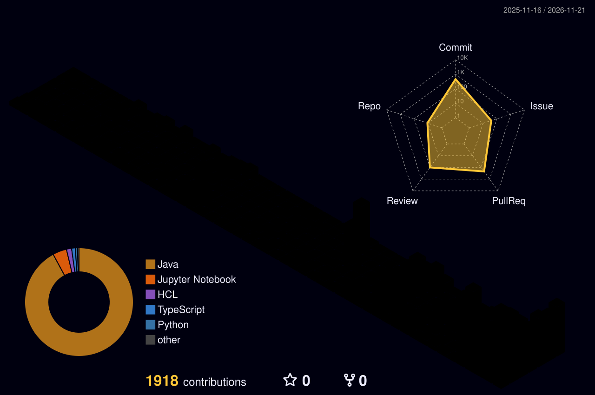

<!-- Header -->

  

  

<!-- 주력 기술 -->

  

  
  
  

 

## 👋 About Me

커머스 실무에서 **CDC 데이터 파이프라인**, **상품 관리 자동화 시스템**, **업무 자동화 시스템**을 만들어 온 백엔드 개발자입니다. 
NestJS와 Spring Boot로 서비스를 개발하고, CI/CD부터 k3s 배포까지 직접 구성합니다.

 

## 🛠 Tech Stack

  
  
  
   
  
  
  
  
  
  
   
  
  
  
  
   
  
  
  
  
  
  
   
  
  
  
  
  
  
  
   
  
  
  
  
   
  
  

 

## 📊 GitHub Stats

  
  

<!-- 3D 잔디: .github/workflows/profile-3d.yml 이 처음 실행된 뒤에 보입니다 -->

  

<!-- Footer -->

  

